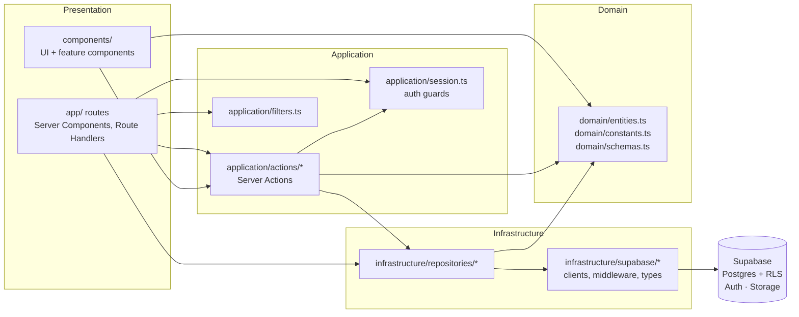
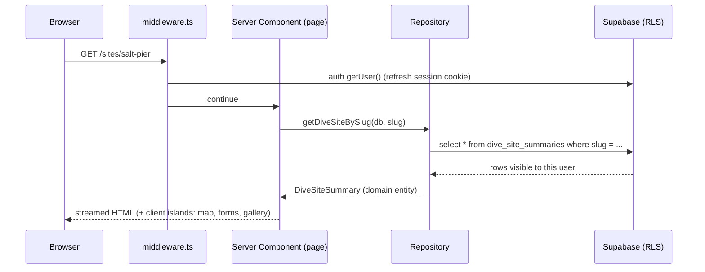
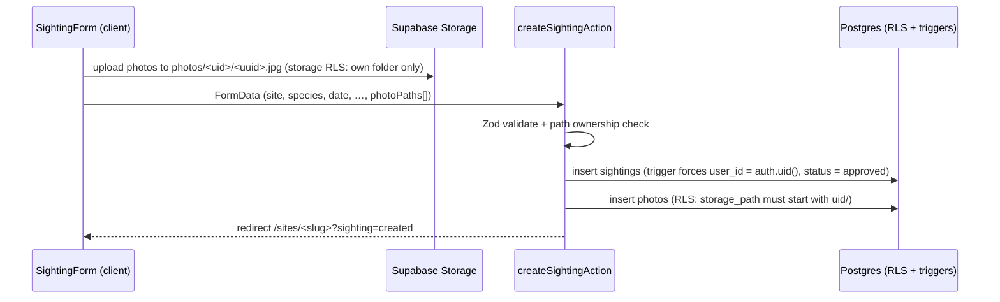
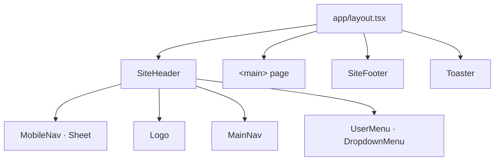
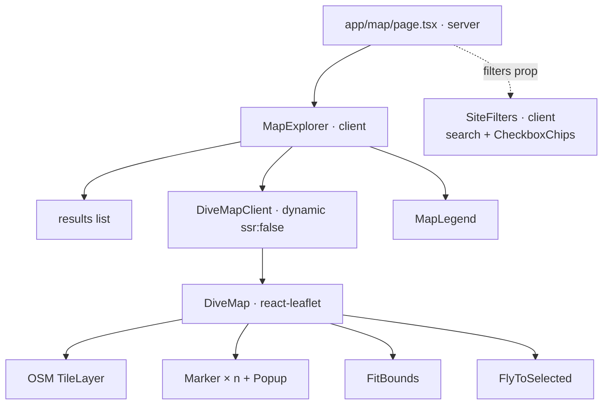
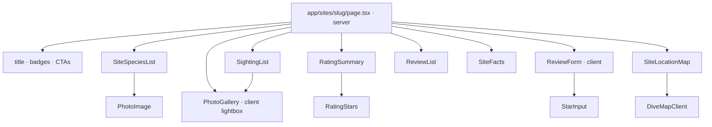
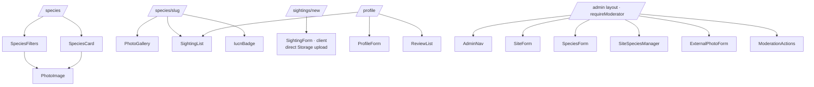

# Architecture

OpenDive Atlas is a Next.js 15 App Router application backed by Supabase. It uses a **layered / clean architecture**: business concepts live in a framework-free core, data access is isolated behind repositories, and the UI depends only on inner layers.

## Layers



| Layer | Folder | Responsibility | May import |
| --- | --- | --- | --- |
| Domain | `src/domain` | Entities, enums/labels, Zod validation schemas | nothing app-specific (only `zod` and generated DB enum types) |
| Infrastructure | `src/infrastructure` | Supabase clients (server/browser/middleware), repositories, row→entity mappers | domain |
| Application | `src/application` | Session & role guards, Server Actions (use cases), API helpers | domain, infrastructure |
| Presentation | `src/app`, `src/components` | Routes, layouts, UI components | all of the above |

**Authorisation is enforced twice:** server actions check the caller's role for good UX and clear errors, and **Postgres Row Level Security** is the source of truth — every query runs with the user's JWT, never a service-role key.

## Request flow



### Submitting a sighting with photos



Uploading directly from the browser to Storage avoids the ~4.5 MB request body limit of Vercel functions.

## Component hierarchy

### Global layout



### Map explorer (`/map`)



### Dive site page (`/sites/[slug]`)



### Species, sightings, admin



## Folder structure

```
opendive-atlas/
├── .github/workflows/ci.yml       # lint, typecheck, build, DB migrations + lint
├── docs/                          # architecture, database, API, env, deployment
├── scripts/verify-seed-photos.mjs # validates Commons photos, fetches attribution
├── supabase/
│   ├── config.toml                # local Supabase stack config
│   ├── migrations/                # schema, RLS, storage, views & RPCs
│   └── seed.sql                   # sites, species, relationships, photos
└── src/
    ├── middleware.ts              # session refresh + protected route redirects
    ├── domain/                    # entities.ts, constants.ts, schemas.ts
    ├── infrastructure/
    │   ├── supabase/              # server.ts, client.ts, middleware.ts, env.ts, storage.ts, database.types.ts
    │   └── repositories/          # dive-sites, species, sightings, reviews, photos, profiles, mappers, errors
    ├── application/
    │   ├── session.ts             # getSessionUser, requireUser/Admin/Moderator
    │   ├── action-state.ts        # ActionState + error mapping
    │   ├── filters.ts             # URL → typed filters
    │   ├── api.ts                 # JSON route handler wrapper
    │   └── actions/               # auth, profile, sightings, reviews, admin
    ├── components/
    │   ├── ui/                    # shadcn/ui primitives
    │   ├── layout/ shared/        # header, footer, nav, form helpers, images
    │   ├── map/ sites/ species/   # feature components
    │   ├── photos/ sightings/ reviews/ auth/ profile/ admin/
    └── app/                       # routes (see below)
```

### Routes

| Route | Access | Purpose |
| --- | --- | --- |
| `/` | public | Landing, stats, featured sites, latest sightings |
| `/map` | public | Interactive map + filters |
| `/sites`, `/sites/[slug]` | public | Directory and site detail |
| `/species`, `/species/[slug]` | public | Catalog and species profile |
| `/sightings` | public | Community feed |
| `/sightings/new` | signed in | Submit a sighting |
| `/login`, `/signup`, `/auth/callback` | public | Auth |
| `/profile` | signed in | Edit profile, my sightings & ratings |
| `/admin/**` | moderator/admin | Management & moderation |
| `/api/**` | public | Read-only JSON API |

## Key design decisions

- **RLS-first security.** No service-role key in the app. Triggers prevent users from forging `status`, `user_id`/`uploaded_by` or escalating `role`.
- **Post-moderation.** Community content is published immediately (`status = approved`) and moderators can hide it. Switch the trigger default to `pending` for pre-moderation.
- **Read models in SQL.** `dive_site_summaries` and `site_species_sighting_stats` views (security invoker) aggregate ratings and sightings; `search_dive_sites` / `search_species` RPCs keep filtering in Postgres and escape user input.
- **URL as filter state.** Filters are query parameters, so searches are shareable and server-rendered.
- **Client islands only where needed.** Leaflet, forms with uploads, galleries and filters are client components; everything else is a Server Component.
- **Plain `` for photos.** Avoids Vercel image-optimisation quotas for user content; a graceful placeholder handles broken URLs.
