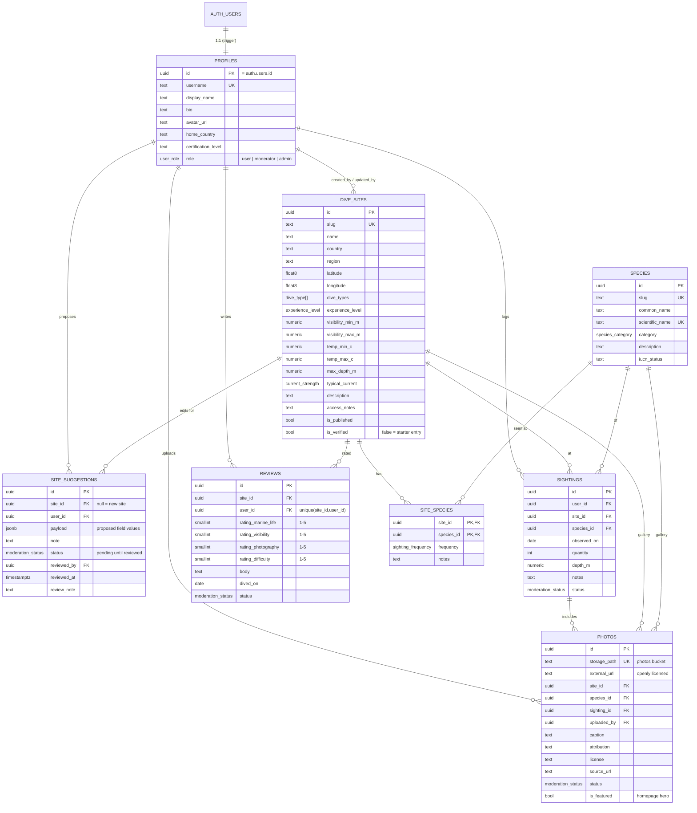

# Database

PostgreSQL on Supabase. Schema, policies and seed data are version-controlled in `supabase/`.

| File | Contents |
| --- | --- |
| `migrations/20261011000001_core_schema.sql` | Enums, tables, constraints, indexes, triggers (`updated_at`, new-user profile, role & moderation guards) |
| `migrations/20261011000002_rls_policies.sql` | Row Level Security policies for every table |
| `migrations/20261011000003_storage.sql` | `photos` Storage bucket and object policies |
| `migrations/20261011000004_views_and_search.sql` | `dive_site_summaries`, `site_species_sighting_stats`, `search_dive_sites()`, `search_species()` |
| `migrations/20261011000005_harden_helpers.sql` | Moves role helpers to the non-exposed `private` schema |
| `migrations/20261013000007_featured_photos_and_squirrelfish.sql` | `photos.is_featured` (homepage hero), admin uploads to `site/`, long-spined squirrelfish |
| `migrations/20261013000009_site_verification_and_suggestions.sql` | `dive_sites.is_verified`, `site_suggestions` table + RLS |
| `migrations/20261013000010_starter_dive_sites.sql` | 211 unverified starter dive sites across all regions |
| `migrations/20261013000011_consolidate_policies.sql` | Merges owner/moderator policies into one per action (performance) |
| `migrations/20261013000012_moderator_site_permissions.sql` | Moderators can read drafts, add and edit dive sites, and review site suggestions |
| `migrations/20261013000013_top_contributors.sql` | `profiles.is_top_contributor`, `contributor_invites`, auto-invite trigger, `respond_contributor_invite()` |
| `migrations/20261013000014_top_contributor_at_50.sql` | Invitation is sent on the 50th approved new site instead of the 51st |
| `migrations/20261013000015_starter_species.sql` | 277 starter species across all categories (no site links) |
| `migrations/20261013000016_species_suggestions.sql` | `species_suggestions` table and `review_species_suggestion()` |
| `seed.sql` | 10 dive sites, 33 species, 64 site–species links, 32 reference photos (idempotent) |

## ERD



## Enums

| Enum | Values |
| --- | --- |
| `user_role` | user, moderator, admin |
| `dive_type` | reef, wreck, shore, boat, freshwater, wall, drift, muck, cavern |
| `experience_level` | beginner, intermediate, advanced |
| `current_strength` | none, mild, moderate, strong |
| `species_category` | fish, shark_ray, reptile, mammal, cephalopod, crustacean, mollusc, coral, invertebrate |
| `sighting_frequency` | rare, occasional, common, abundant |
| `moderation_status` | pending, approved, rejected |
| `invite_status` | pending, accepted, declined |

## Row Level Security

All tables have RLS enabled. Helper functions `private.is_admin()` and `private.is_moderator()` are `SECURITY DEFINER` with an empty `search_path`, and live in a `private` schema that PostgREST does not expose.

| Table | Select | Insert | Update | Delete |
| --- | --- | --- | --- | --- |
| profiles | everyone | via signup trigger only | self; admin (any) | — (cascades from auth.users) |
| dive_sites | published, or moderator | moderator | moderator | admin |
| species | everyone | admin | admin | admin |
| site_species | everyone | admin | admin | admin |
| sightings | approved, own, or moderator | self (`user_id = auth.uid()`) | own; moderator | own; moderator |
| photos | approved, own, or moderator | self, own storage folder, own sighting; admin (any incl. external URLs) | own; moderator | own; moderator |
| reviews | approved, own, or moderator | self | own; moderator | own; moderator |
| site_suggestions | own, or moderator | self (forced `pending`) | moderator | own while pending; admin |
| contributor_invites | own, or moderator | — (trigger only) | — (via `respond_contributor_invite()`) | — |
| species_suggestions | own, or moderator | self (forced `pending`) | — (via `review_species_suggestion()`) | own while pending; admin |

### Guard triggers

- `protect_profile_role` — non-admins cannot change `profiles.role` or `profiles.is_top_contributor` (trusted `SECURITY DEFINER` functions can).
- `site_suggestions_offer_top_contributor` — when a new-site suggestion is approved and its author now has 50 or more approved new sites, creates a pending `contributor_invites` row (once per diver).

### Species suggestions

Divers suggest a missing species (`species_id` null) or corrections to an existing one; edits store only the changed fields. Moderators review them with `review_species_suggestion(suggestion_id, approve, reviewer_note)`, a `SECURITY DEFINER` function that checks `private.is_moderator()`, applies the change (or inserts the species with a unique slug) and records the review in one transaction. Moderators can therefore approve species changes without having direct write access to `species`, which stays admin-only. A duplicate scientific name aborts the approval. Species suggestions don't count toward Top Contributor invitations.

### Top Contributor invitations

1. The trigger above creates the invitation.
2. After approving a new site, the app calls the `send-contributor-invites` Edge Function. It claims every unsent invitation (`email_sent_at`), emails it through Resend, and releases the claim if sending fails, so the next call retries.
3. The email links to `/contributor/invite/<id>`. After signing in, the diver accepts or declines. `respond_contributor_invite(invite_id, accept)` checks the invitation belongs to the caller, sets `is_top_contributor`, and promotes a `user` to `moderator`. Existing moderators and admins keep their role. A declined invitation can still be accepted later.
- `protect_moderated_row` (sightings, photos, reviews) — for non-moderators, forces `status = 'approved'` on insert, keeps `status` unchanged on update, and pins the owner column to `auth.uid()`. Trusted contexts without a JWT subject (SQL editor, migrations, seed) are not affected.

### Storage (`photos` bucket)

- Public bucket (files served by public URL), 10 MiB limit, JPEG/PNG/WebP/AVIF.
- Upload: authenticated users, only into `<auth.uid()>/…`.
- Delete/list: owner folder or moderators.

## Read models

- **`dive_site_summaries`** — every `dive_sites` column plus `review_count`, `avg_marine_life`, `avg_visibility`, `avg_photography`, `avg_difficulty`, `avg_overall` (mean of marine life, visibility, photography), `sighting_count`, `species_count`.
- **`site_species_sighting_stats`** — `(site_id, species_id, sighting_count, last_sighted_on)` from approved sightings.
- **`search_dive_sites(q, types[], levels[])`** — case-insensitive match on name/country/region; a site matches if it has **any** selected dive type and **any** selected level.
- **`search_species(q, categories[])`** — matches common or scientific name.

All views use `security_invoker = true`, so RLS of the caller applies.

## Migrations workflow

```bash
npx supabase migration new add_something   # create a new migration file
npm run db:reset                           # rebuild local DB from migrations + seed
npx supabase db lint                       # static checks
npx supabase link --project-ref <ref>      # once per machine
npm run db:push                            # apply pending migrations to the remote project
```

To load the seed into a remote project: `psql "$DATABASE_URL" -f supabase/seed.sql` (the seed is idempotent), or paste it into the Studio SQL editor.

## Seed photos

Reference photos point to Wikimedia Commons via `Special:FilePath`. Run `npm run seed:verify-photos -- --sql photo-credits.sql` to list missing files and generate `UPDATE` statements that fill in the real author and licence for each photo. The UI shows a placeholder for any image that fails to load.
